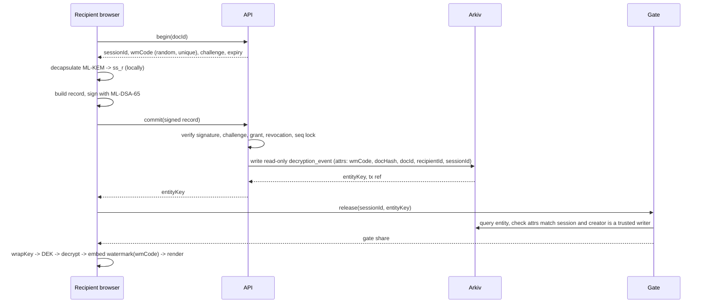
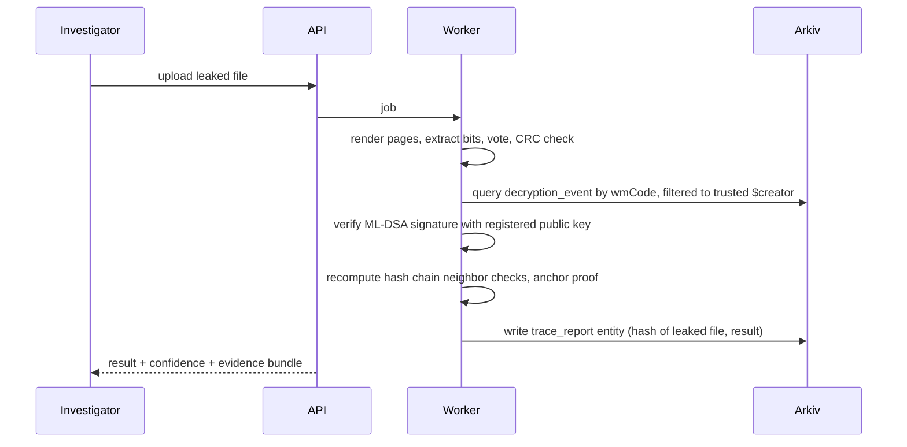

# ArcTrace: Architecture

## 1. Principles
1. **Plaintext lives only in the recipient's browser.** The server stores ciphertext and metadata.
2. **Private keys never leave the browser.**
3. **Commit before release.** A document is shown only after its decryption record is on Arkiv.
4. **Arkiv is the source of truth for audit records.** Postgres holds working state and can be rebuilt from Arkiv plus blobs.
5. **Every external dependency sits behind an adapter** (ledger, blob store, KMS) with a mock for tests.
6. **Fail closed.** If the ledger or gate is down, nobody opens documents.

## 2. Components
```
                       +--------------------+
                       |   Arkiv network    |   (testnet now; private DB-Chain later)
                       +---------+----------+
                                 ^  write / query
        +------------------------+------------------------+
        |                        |                        |
+-------+--------+      +--------+--------+      +--------+--------+
|   API service  |      |  Gate service   |      | Witness + Keeper |
|  (Fastify)     |      |  (separate proc)|      | (separate creds) |
+---+--------+---+      +--------+--------+      +------------------+
    |        |                   ^
    |        v                   | gate share (after it sees the Arkiv entity)
    |   +----------+     +-------+--------+
    |   | Postgres |     |  Web app (Next)|  <- keys, AES, ML-KEM, ML-DSA,
    |   +----------+     |  + Web Workers |     watermark embed, PDF render
    v                    +----------------+
+--------+
| S3/MinIO| ciphertext blobs only
+--------+

Investigator worker (Node): watermark extraction, trace jobs, evidence bundles
CLI: arctrace-verify (offline and Arkiv-backed verification)
```

| Component | Responsibility | Trust level |
|---|---|---|
| Web app + workers | Key generation, encryption, decryption, watermark embed, signing | Runs on the recipient's device. Untrusted for enforcement, trusted for the recipient's own signature |
| API | Auth, RBAC, metadata, challenge/commit orchestration, outbox to Arkiv, trace jobs | Semi-trusted. Cannot decrypt, cannot forge recipient signatures |
| Gate | Holds the gate master key. Releases a key share only if Arkiv shows the commit | Trusted for availability and withholding only |
| Witness | Mirrors Arkiv records to write-once storage. Alerts on missing or changed records | Independent credentials and host |
| Keeper | Extends Arkiv expiry for records under retention | Independent job |
| Investigator worker | Extraction and trace on uploaded leaked files | Handles leaked content, isolated |

## 3. Key hierarchy
- **Recipient keys (browser):** ML-KEM-768 pair (receive wrapped keys), ML-DSA-65 pair (sign records). Private keys encrypted at rest in IndexedDB with a key from Argon2id(passphrase). Encrypted backup file `.tvkey` exported on request.
- **Document key (DEK):** random 256-bit AES key, per document version.
- **Wrap key (per recipient):** `HKDF(ss_r || gate_share, salt=docId, info="tv-wrap-v1")` where `ss_r` is the ML-KEM shared secret and `gate_share` is zeros when the gate is off.
- **Gate share:** `HKDF(gateMaster, salt=docId, info="gate|recipientId|keyVersion")`. Master key lives in KMS (env var in dev).
- **Org anchor key:** ML-DSA-65 key that signs Merkle anchors. Lives in KMS.
- **Arkiv wallets:** a **writer** wallet creates and pays for entities. An **auditor** wallet (ideally a multisig held by a different team) receives ownership after creation through `transferEntityOwnership`. Both addresses are in config. The writer set is the trusted set for every `$creator` filter.

## 4. Main flows

### 4.1 Share
```mermaid
sequenceDiagram
  participant S as Sender browser
  participant API
  participant G as Gate
  participant A as Arkiv
  S->>S: DEK = random; ciphertext = AES-GCM(DEK, file)
  S->>API: GET recipient public keys
  S->>G: request gate shares for recipients (authz: owns doc)
  S->>S: per recipient: ML-KEM encaps -> wrap DEK
  S->>API: upload ciphertext, manifest, grants, sender ML-DSA signature
  API->>A: commit doc_manifest + grant_event entities
  API-->>S: docId, ledger refs
```

### 4.2 Open (the core flow)

Gate off (PoC): skip the gate steps. The browser unwraps with `ss_r` only. State clearly in the UI and docs that a client can bypass the commit in this mode.

### 4.3 Trace


## 5. Arkiv data model
All entities carry `schema`, `kind`, `orgId`, `ts`. Payloads are canonical JSON (RFC 8785). IDs are random UUIDs or hex. No PII.

| kind | Indexed attributes | Payload |
|---|---|---|
| `key_registration` | `userId`, `keyId`, `kemFp`, `sigFp` | public keys, proof-of-possession signature |
| `doc_manifest` | `docId`, `version`, `senderId` | ciphertext SHA-256, recipient-set hash, sender signature |
| `grant_event` | `docId`, `recipientId`, `action` (`grant`/`revoke`) | signer, signature |
| `decryption_event` | `docId`, `docHash`, `recipientId`, `wmCode`, `sessionId`, `seq` | signed record, `prevRecordHash` |
| `anchor` | `orgId`, `fromSeq`, `toSeq` | Merkle root, leaf count, anchor signature |
| `trace_report` | `traceId`, `docId`, `wmCode` | leaked file hash, confidence, investigator signature |

**Creation rules (every entity):**
1. Create with `readOnly: true`. If spike S1 shows this blocks something we need (for example lifetime extension), record the exception in `docs/decisions.md`.
2. Public attributes follow the policy in spec.md section 4.3. Personal data, file names and titles never appear.
3. Write with the writer wallet, then call `transferEntityOwnership` to the auditor wallet in a retried background job.
4. Every lookup filters by `$creator` in the trusted writer set.
5. Payload mode is `plain` (demo default) or `sealed` (production, encrypted to an audit key).

**Expiry (retention policy):** set to N months from config (for example 12 in the demo, per policy in production). The keeper uses lifetime extension when remaining life is below 30% and an inquiry is open or policy requires it.
**Open questions that change this model** are listed in idea.md. Record answers in `docs/arkiv-notes.md`.

## 6. Integrity: how "no admin can erase or rewrite it" is argued honestly
Layers, strongest first. Confirm each Arkiv behavior in spike S1 before claiming it in the pitch.
1. **Read-only records.** Every entity is created with `readOnly: true`, so nobody can patch it later.
2. **Ownership transfer.** The writer wallet creates entities, then transfers ownership to an auditor wallet (a multisig held by another team). The writer can no longer act on them.
3. **Creator-filtered lookups.** Anyone can write to a public chain. Every lookup (trace, gate, verifier) accepts only entities whose `$creator` is in the trusted writer set, so a planted fake record is ignored.
4. **Per-document hash chain.** Each event has `seq` and `prevRecordHash`. Any gap shows up.
5. **Merkle anchors.** Every N events or T minutes an `anchor` entity commits a root. Optional L1/L2 anchor later.
6. **Witness mirror.** Separate service and credentials, write-once storage, alerts on missing or altered entities.
7. **Recipient receipts.** Each recipient can download their own signed record.

Open points for S1: does read-only block deletion, does it block lifetime extension, does transfer work on read-only entities. The pitch claim stays: "tampering is prevented where Arkiv enforces it and detected everywhere else, and the evidence survives."

## 7. Watermarking architecture
- Runs in a Web Worker in the recipient's browser. PDFs render page by page with pdf.js; each page canvas gets the watermark before display.
- Code: 64-bit `wmCode` plus 16-bit CRC, repeated across the page (every page carries the full payload).
- Layers: **L2 raster DCT** (primary, robust), **L1 text layout** and zero-width marks (for downloads and text), **L3 metadata** (fragile, secondary).
- Extraction runs server-side in the investigator worker with the same TypeScript package.
- Details and parameters are in spec.md section 5.

## 8. Deployment
- **Dev:** `docker compose up` starts Postgres, MinIO, API, gate, witness, web, and a mock ledger or the real Arkiv testnet depending on env.
- **Prod (simple):** containers on a VM or Fly/Render, managed Postgres, S3-compatible storage, KMS or Vault for keys, Caddy or Nginx for TLS.
- **Separation:** gate and witness deployed with different credentials, ideally a different cloud account.
- **Config:** 12-factor env vars. `LEDGER_MODE=arkiv|mock`, `GATE_MODE=on|off`.

## 9. Failure modes
| Failure | Behavior |
|---|---|
| Arkiv unreachable | Open fails closed. UI shows retry. Outbox queues non-blocking events (manifests, anchors) |
| Commit succeeded but response lost | Retry with same `sessionId`. Commit is idempotent |
| Gate down | Open fails closed |
| Witness sees a missing entity | Alert, mark org as "integrity incident", keep mirror data |
| Key lost | Recipient requests rotation. Admin revokes the old key. Old documents are re-wrapped by the sender |
| Clock skew | Arkiv block time is authoritative. Client time is informational |

## 10. Threat model
| Threat | Defense | Residual risk |
|---|---|---|
| Recipient leaks and denies | ML-DSA signature on the record. Watermark ties the leaked copy to the session | Recipient claims key theft; passphrase plus device binding reduce it |
| Admin edits or deletes records | Read-only records, ownership moved to an auditor wallet, hash chain, anchors, witness | Depends on what Arkiv enforces (S1); anything it does not enforce is detectable |
| Attacker plants a fake record on the public chain | `$creator` filter on every lookup; signature checked against a registered key (itself creator-filtered) | None known |
| Compromised API | Cannot decrypt. Cannot forge recipient signature. Gate checks Arkiv independently | Can deny service |
| Compromised gate alone | Has only its share. Cannot decrypt | Can withhold |
| Recipient decrypts offline with own key | Gated release (needs gate share) | Gate off mode is bypassable |
| Watermark removal by noise, crop, rescale | Redundant DCT embedding, attack suite, confidence score | Strong attacks may succeed |
| Collusion across recipients | Not covered in v1 | Stretch: fingerprint codes |
| Replay of an old record | Server challenge, unique `sessionId`, expiry | None known |
| Harvest-now-decrypt-later | ML-KEM for wraps, AES-256 for data | Depends on library correctness |
| PII leak via public chain | Pseudonymous IDs only | Metadata patterns (timing) remain |

## 11. Architecture decisions (ADRs, short)
- **ADR-1 TypeScript everywhere.** One language for browser, API and worker lets watermark embed and extract share code.
- **ADR-2 `@noble/post-quantum`.** Pure TS, no native build, runs in the browser. Cost: not hardware accelerated; fine for this scale.
- **ADR-3 DCT differential embedding over deep-learning watermarks.** Simple, testable, fast in a worker. Cost: weaker against photos.
- **ADR-4 Gate as 2-of-2 key share.** Gives real commit-before-release without letting the gate decrypt alone.
- **ADR-5 Outbox pattern** for non-blocking ledger writes. The open flow uses a synchronous commit with timeout.
- **ADR-6 View-only default.** Raster viewer gives the most robust watermark and least leakage surface.
- **ADR-7 Read-only, ownership transfer and creator filter** instead of relying on detection alone. Cost: depends on Arkiv semantics we must confirm in S1.
- **ADR-8 Sealed payload is a production option.** The demo keeps payloads readable so judges can inspect records. Attributes stay minimal in both modes.